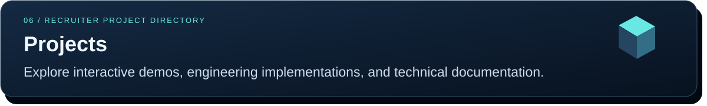

<!-- Professional SVG profile for Santhosh Banoth. All artwork is stored in this repository. -->

  

## 

| Specialism | Tools and practical skills |
|---|---|
| **Security operations** | Alert triage, incident response, threat hunting, phishing investigation, evidence handling |
| **Security platforms** | Microsoft Sentinel, Defender XDR, Entra ID, Splunk, Elastic Security |
| **Detection engineering** | KQL, MITRE ATT&CK, event correlation, analytic rules, false-positive tuning |
| **Automation and development** | PowerShell, Python, Bash, SQL, REST APIs, Azure Logic Apps |
| **Engineering practice** | Git, GitHub Actions, input validation, regression testing, structured reporting |
| **Identity and networking** | IAM, MFA, Conditional Access, TCP/IP, DNS, Wireshark |
| **Governance** | NIST CSF, ISO 27001, CIS Controls, vulnerability management |

Professional skills reflect my CV. Project repositories below show the specific implementations, evidence, and tests available for review.

## 

### Professional certifications

| Certification | Issuer |
|---|---|
| Security Operations Analyst Associate · **SC-200** | Microsoft |
| **Security+** | CompTIA |

### Education

| Qualification | Institution | Period |
|---|---|---|
| **MSc Advanced Computer Science** | University of Liverpool, United Kingdom | 2023–2025 |
| **B.Tech Computer Science** | Guru Nanak Institutions Technical Campus, India | 2017–2021 |

Qualifications are listed from my CV; public credential verification links are not yet included.

## 

### Interactive web demos

Explore the published demo, then follow the source link for architecture, implementation, and setup details.

| Project | What to explore | Links |
|---|---|---|
| **UK Live Transport Intelligence** | TfL journey planning and arrival predictions, with separate pipeline analytics. | [Open demo](https://uk-live-transport-intelligence.streamlit.app) · [Source](https://github.com/Banoth281/uk-live-transport-intelligence) |
| **UK Energy & Carbon Intelligence** | Regional carbon-intensity and electricity-generation insights. | [Open demo](https://live-uk-energy-intelligence-dvyys7acaxutsx6v2lo9ao.streamlit.app/) · [Source](https://github.com/Banoth281/live-uk-energy-intelligence) |
| **Banking Fraud Detection Lakehouse** | Synthetic banking analytics and a Bronze / Silver / Gold engineering design. | [Open demo](https://real-time-fraud-detection-lakehouse-jfsazacdwjdgkz6gplthwv.streamlit.app/) · [Source](https://github.com/Banoth281/real-time-fraud-detection-lakehouse) |
| **Commerce Data Pipeline** | Synthetic order analytics, revenue metrics, and processing latency. | [Open demo](https://real-time-commerce-data-pipeline-db39b7gmu7trypz8vlj6sg.streamlit.app/) · [Source](https://github.com/Banoth281/real-time-commerce-data-pipeline) |
| **UK Retail Sales Analytics** | Sales, profitability, regional performance, and returns using synthetic retail data. | [Open demo](https://banoth281.github.io/uk-retail-sales-analytics/) · [Source](https://github.com/Banoth281/uk-retail-sales-analytics) |
| **Retail Decision Studio** | CSV sales analysis, repeat-customer metrics, and campaign scenarios. | [Open demo](https://banoth281.github.io/retail-growth-retention-decision-studio/) · [Source](https://github.com/Banoth281/retail-growth-retention-decision-studio) |
| **SAP Incident Management** | Browser simulation of incident workflows and business rules. | [Open demo](https://banoth281.github.io/sap-incident-management/) · [Source](https://github.com/Banoth281/sap-incident-management) |

Demo data and availability

These URLs are published in the project repositories; availability has not been confirmed for every service. Energy, banking, and commerce dashboards may show saved demonstration data when their backend is unavailable. The transport app distinguishes direct TfL requests from saved pipeline analytics. The SAP browser demo simulates the full application's workflows.

### Security investigations and detection

<table>
<tr>
<td width="50%" valign="top">

<h4>SOC Investigation &amp; Detection Portfolio</h4>

Windows Event 4625 analysis and phishing investigation, supported by reusable PowerShell tools, sanitised evidence, reports, and automated checks.

<b>PowerShell · Windows Security · Evidence analysis</b>

<a href="https://github.com/Banoth281/soc-login-lab">Review investigations and code →</a>

</td>
<td width="50%" valign="top">

<h4>Multi-Account Failure Detection</h4>

Python authentication correlation using distinct-account thresholds, rolling windows, validated synthetic records, and structured findings.

<b>Python · Event correlation · Regression testing</b>

<a href="https://github.com/Banoth281/soc-password-spray-lab">Review detector and investigation →</a>

</td>
</tr>
</table>

### Additional engineering work

| Project | Engineering focus | Review |
|---|---|---|
| **Real-Time Crypto Pipeline** | REST ingestion, Kafka, PySpark Streaming, and a locally run Streamlit dashboard. | [Code and setup](https://github.com/Banoth281/realtime-crypto-pipeline) |
| **Personal Finance & Bill Tracker** | CSV validation, transaction categorisation, PostgreSQL storage, and spending analytics. | [Code and setup](https://github.com/Banoth281/smart-personal-finance-tracker) |
| **C/C++ Cryptographic Engine** | Modular C implementation, build instructions, and automated checks. | [Code and setup](https://github.com/Banoth281/crypto-c-engine) |

The security labs and additional engineering projects provide repository-based review and local execution instructions; public hosted demos are not documented for these implementations.

### Academic research and technical learning

**3D Rock-Paper-Scissors Combat Arena**  
Unity / C# dissertation work featuring adaptive finite-state-machine agents.

[Watch presentation](https://liverpool.instructuremedia.com/embed/ecdc0b68-ef36-4850-a924-5a1b80e6143a) · [Project repository](https://github.com/Banoth281/RPS) · [Additional Unity implementation](https://github.com/Banoth281/unity-3d-rock-paper-scissors-arena-main)

**Software Engineering vs. Data Engineering Roadmaps**  
Architecture notes, learning paths, and engineering workflows.

[Read the technical guide](https://github.com/Banoth281/SE-vs-DE-Technical-Roadmaps)

  
  

