<!-- Professional SVG profile for Santhosh Banoth. All artwork is stored in this repository. -->

  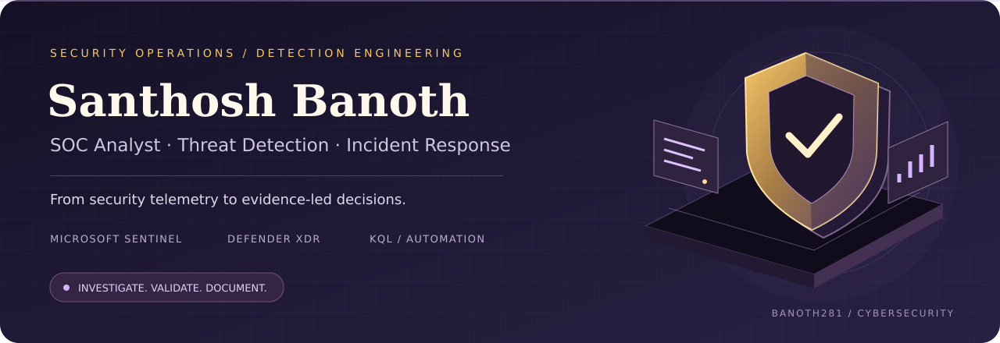

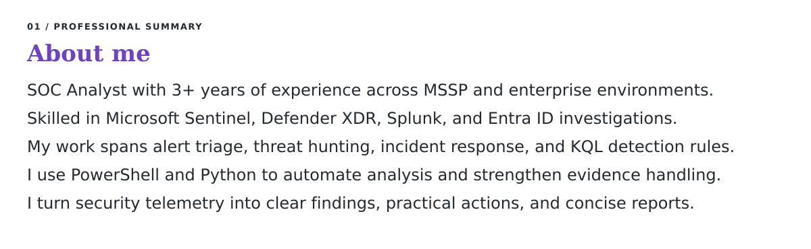

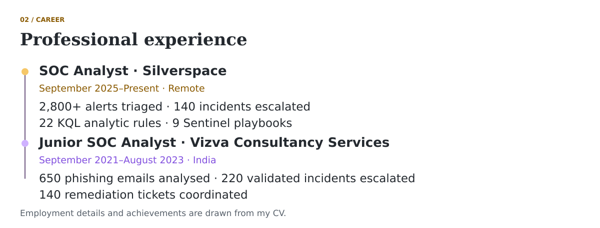

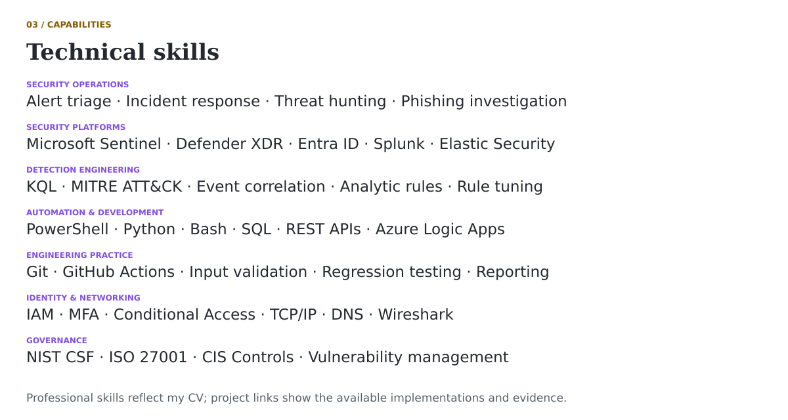

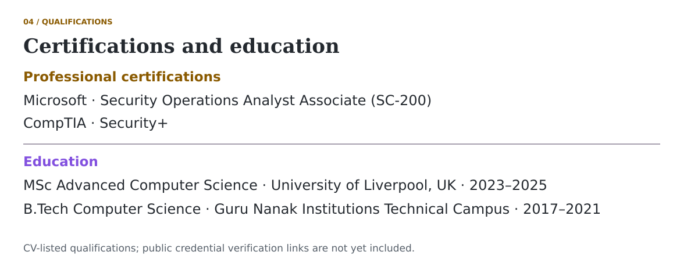

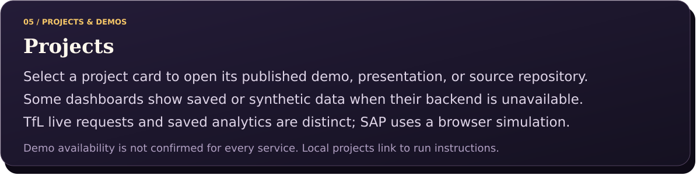

<table>
<tbody>
<tr>
<td width="80%" valign="middle"><a href="https://uk-live-transport-intelligence.streamlit.app">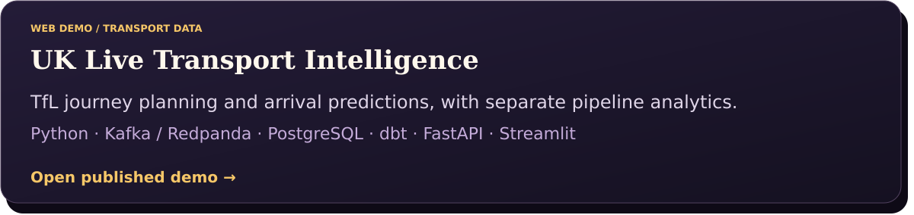</a></td>
<td width="20%" align="center" valign="middle"></td>
</tr>
<tr>
<td width="80%" valign="middle"><a href="https://live-uk-energy-intelligence-dvyys7acaxutsx6v2lo9ao.streamlit.app/">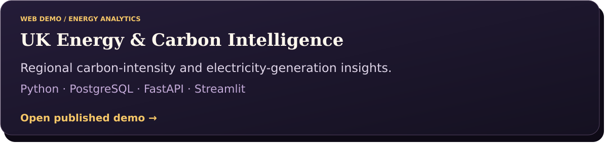</a></td>
<td width="20%" align="center" valign="middle"></td>
</tr>
<tr>
<td width="80%" valign="middle"><a href="https://real-time-fraud-detection-lakehouse-jfsazacdwjdgkz6gplthwv.streamlit.app/">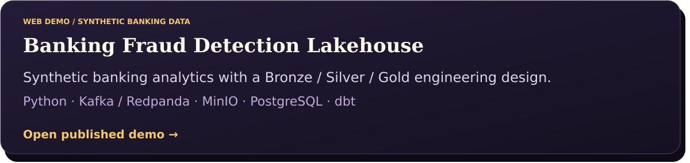</a></td>
<td width="20%" align="center" valign="middle"></td>
</tr>
<tr>
<td width="80%" valign="middle"><a href="https://real-time-commerce-data-pipeline-db39b7gmu7trypz8vlj6sg.streamlit.app/">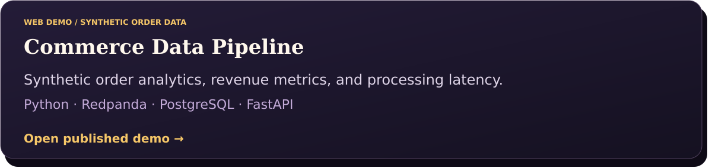</a></td>
<td width="20%" align="center" valign="middle"></td>
</tr>
<tr>
<td width="80%" valign="middle"><a href="https://banoth281.github.io/uk-retail-sales-analytics/">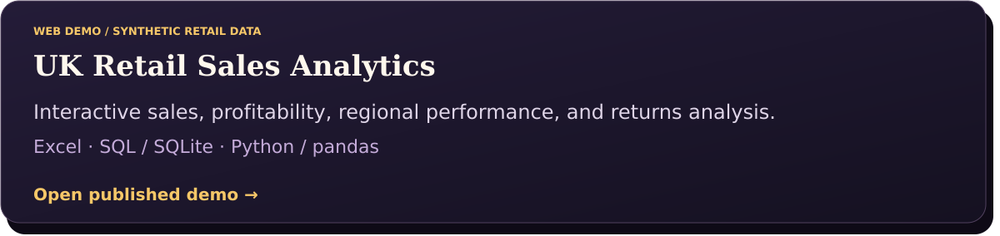</a></td>
<td width="20%" align="center" valign="middle"></td>
</tr>
<tr>
<td width="80%" valign="middle"><a href="https://banoth281.github.io/retail-growth-retention-decision-studio/">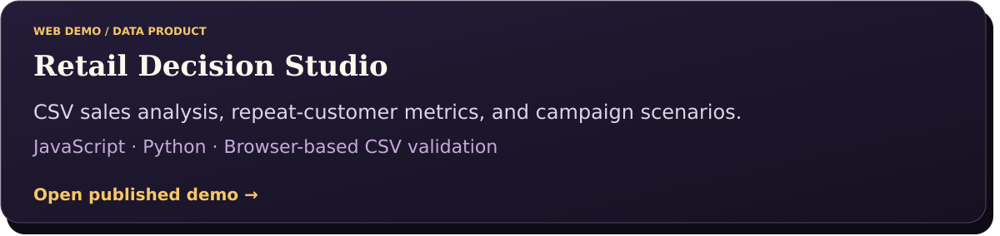</a></td>
<td width="20%" align="center" valign="middle"></td>
</tr>
<tr>
<td width="80%" valign="middle"><a href="https://banoth281.github.io/sap-incident-management/">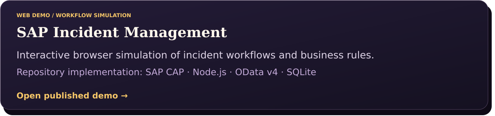</a></td>
<td width="20%" align="center" valign="middle"></td>
</tr>
<tr>
<td width="80%" valign="middle"><a href="https://github.com/Banoth281/soc-login-lab">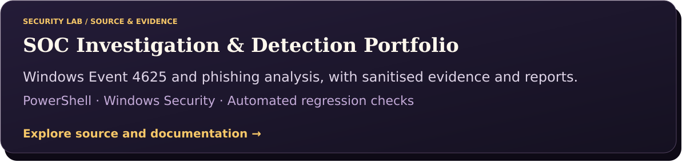</a></td>
<td width="20%" align="center" valign="middle"></td>
</tr>
<tr>
<td width="80%" valign="middle"><a href="https://github.com/Banoth281/soc-password-spray-lab">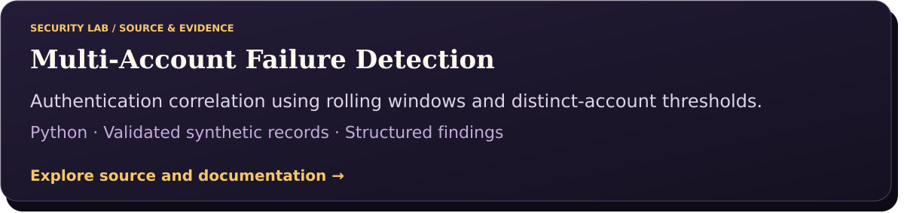</a></td>
<td width="20%" align="center" valign="middle"></td>
</tr>
<tr>
<td width="80%" valign="middle"><a href="https://github.com/Banoth281/realtime-crypto-pipeline">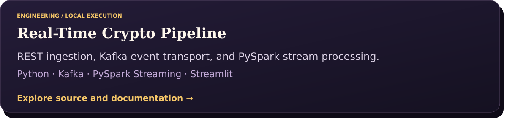</a></td>
<td width="20%" align="center" valign="middle"></td>
</tr>
<tr>
<td width="80%" valign="middle"><a href="https://github.com/Banoth281/smart-personal-finance-tracker">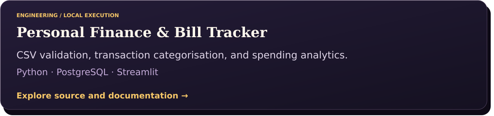</a></td>
<td width="20%" align="center" valign="middle"></td>
</tr>
<tr>
<td width="80%" valign="middle"><a href="https://github.com/Banoth281/crypto-c-engine">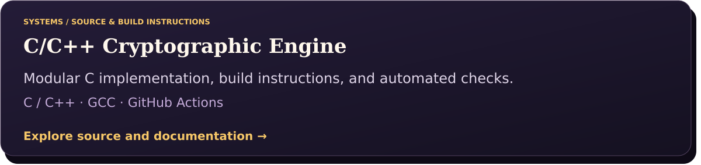</a></td>
<td width="20%" align="center" valign="middle"></td>
</tr>
<tr>
<td width="80%" valign="middle"></td>
<td width="20%" align="center" valign="middle"> </td>
</tr>
<tr>
<td width="80%" valign="middle"></td>
<td width="20%" align="center" valign="middle"></td>
</tr>
</tbody>
</table>

  
  

