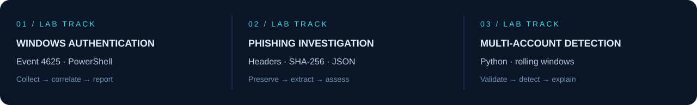
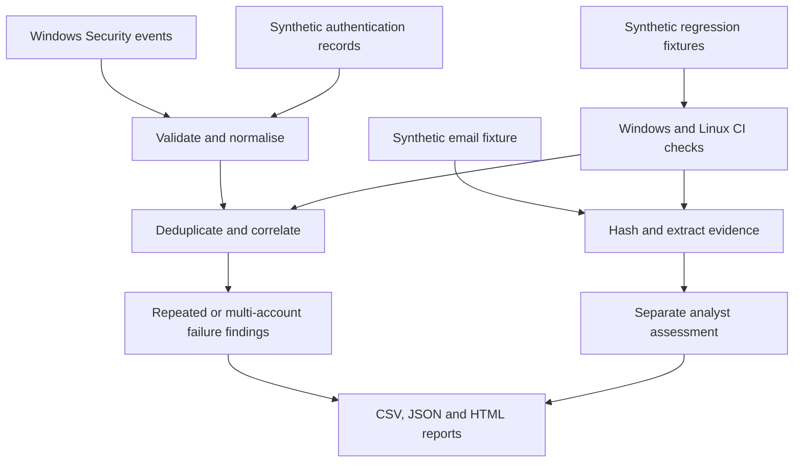

  

  <a href="#featured-engineering-work">PROJECTS</a> &nbsp; / &nbsp;
  <a href="#technical-capabilities">TECHNICAL SKILLS</a> &nbsp; / &nbsp;
  <a href="#professional-experience">EXPERIENCE</a> &nbsp; / &nbsp;
  <a href="#certifications-and-education">CREDENTIALS</a> &nbsp; / &nbsp;
  <a href="https://www.linkedin.com/in/banoth281/">LINKEDIN</a>

## About me

London, United Kingdom  
[LinkedIn](https://www.linkedin.com/in/banoth281/) · [Email](mailto:Santhoshbanoth971@gmail.com) · [SOC portfolio](https://github.com/Banoth281/soc-login-lab) · [Password spray detector](https://github.com/Banoth281/soc-password-spray-lab)

SOC Analyst with **3+ years of experience** across MSSP and enterprise environments, with a focus on Microsoft Sentinel, Defender XDR, KQL, identity investigations, and response automation. MSc Advanced Computer Science, University of Liverpool. Microsoft Certified Security Operations Analyst Associate and CompTIA Security+.

My GitHub portfolio demonstrates the implementation behind an investigation: event collection, evidence validation, detection logic, analyst reasoning, automated tests, and clear reports.

## Featured engineering work

  

| Project | Technical implementation | Verified result | Review |
|---|---|---|---|
| **Windows failed-logon detection v2** | Security Event 4625 XML extraction; strict schema validation; host/domain/account/IP grouping; event identity deduplication; configurable rolling windows; CSV and HTML reports | **31/31 hosted regression checks**; 30 initial v2 checks passed locally; actual collection returned 2 unique events and 0 threshold alerts | [Case study](https://github.com/Banoth281/soc-login-lab/blob/main/windows-event-investigation/CASE-STUDY.md) · [Code](https://github.com/Banoth281/soc-login-lab/tree/main/windows-event-investigation/powershell) · [Local evidence](https://github.com/Banoth281/soc-login-lab/blob/main/windows-event-investigation/evidence/LOCAL-V2-VALIDATION.md) |
| **Phishing email investigation** | SHA-256 sample identification; folded-header and URL extraction; separate evidence/assessment JSON; HTML-encoded reporting; temporary-file tests | **10 extraction checks passed** on Windows; additional report-generation and encoding checks passed; original sample hash independently verified | [Case study](https://github.com/Banoth281/soc-login-lab/blob/main/phishing-email-investigation/CASE-STUDY.md) · [Code](https://github.com/Banoth281/soc-login-lab/tree/main/phishing-email-investigation) · [Validation](https://github.com/Banoth281/soc-login-lab/blob/main/phishing-email-investigation/VALIDATION.md) |
| **Multi-account failure detector** | Python standard library; distinct-account correlation by source IP; deque-backed rolling windows; UTC/IP normalisation; duplicate rejection; structured JSON alerts | **18/18 tests passed on Windows and Linux**; sample report regression preserved 1 alert from 12 valid synthetic records | [Repository](https://github.com/Banoth281/soc-password-spray-lab) · [Detector](https://github.com/Banoth281/soc-password-spray-lab/blob/main/detect_spray.py) · [Audit](https://github.com/Banoth281/soc-password-spray-lab/blob/main/AUDIT.md) |

**For reviewers:** start with a case study, follow the code and validation links, then inspect the automated test run. The badges show current workflow status; the results above refer to documented validation.

## Investigation architecture

Windows PowerShell tests run on Windows; the Python detector runs on Windows and Linux. The diagram summarises separate lab workflows, rather than a deployed unified platform.

## Detection design

### Windows: repeated failures for one account
- **Telemetry:** named XML fields from Security Event **4625**, retaining UTC time, RecordID, Computer, Channel, EventID, Domain, Account, and SourceIP.
- **Grouping:** destination host + account domain + account + canonical source IP; Windows names compare case-insensitively.
- **Identity:** computer + channel + record ID + UTC timestamp. Duplicate copies count once; conflicting payloads with the same identity stop processing.
- **Rule:** at least five failures in an inclusive five-minute window by default, with configurable threshold and window.
- **Implementation:** sorted groups and two window indices; one alert per group per invocation, including contributing record IDs.
- **Validation:** threshold boundaries, host/domain separation, duplicates, malformed inputs, timezone/IPv6 equivalence, HTML encoding, and relative-path output handling.

### Python: failures across distinct accounts
- **Telemetry:** synthetic CSV records containing timestamp, account, source IP, and result.
- **Rule:** one source failing against at least five distinct accounts within five minutes.
- **Implementation:** per-source failure queues, UTC normalisation, alert suppression while the observed count remains active, and JSON snapshots at threshold crossing.
- **Input controls:** missing/duplicate CSV headers, malformed field counts, invalid values, exact normalised duplicates, and input/output path protection.
- **Interpretation:** the pattern warrants investigation; records do not contain attempted passwords and cannot establish password reuse or compromise.

### Email: extraction supports analyst judgment
- Preserve the original sample bytes and identify them using SHA-256.
- Unfold headers and extract body URLs without making network requests.
- Store extracted facts separately from the analyst verdict and response proposals.
- Encode dynamic report text and display URLs without clickable anchors.
- Treat embedded Authentication-Results as unverified fixture text.

## Technical capabilities

| Area | Technologies and practice |
|---|---|
| **Security operations** | Alert triage, incident response, threat hunting, phishing analysis, root cause analysis, containment and remediation, 24/7 handovers |
| **Microsoft security** | Sentinel, Defender XDR, Defender for Endpoint, Defender for Identity, Defender for Cloud, Entra ID, Azure |
| **Detection engineering** | KQL, analytic rules, log correlation, MITRE ATT&CK, Sigma, IOCs, threat intelligence, false-positive tuning |
| **Other security platforms** | Splunk, Elastic Security, SIEM, EDR, XDR |
| **Automation and development** | PowerShell, Python, Bash, SQL, REST APIs, Azure Logic Apps, Sentinel playbooks, Git, GitHub Actions |
| **Identity and networking** | IAM, MFA, Conditional Access, TCP/IP, DNS, Wireshark, firewalls, IDS, Zero Trust |
| **Governance** | NIST CSF, ISO 27001, CIS Controls, Cyber Essentials, vulnerability management, risk assessment, GDPR |

Professional skills above reflect my CV. The featured repositories demonstrate the specific implementations and validation described in their documentation; they are not evidence of a production Sentinel or Defender deployment.

## Professional experience

### SOC Analyst · Silverspace
**September 2025–Present · Remote**

Microsoft Sentinel and Defender XDR alert investigation, Entra ID identity security, KQL detection engineering, threat hunting, and SOAR automation.

Selected achievements from my CV

- Triaged **2,800+ alerts** and escalated **140 confirmed incidents** across an estate of **3,500 identities and endpoints**.
- Developed **22 KQL analytic rules** covering **15 MITRE ATT&CK techniques**.
- Investigated **180** password spray, impossible travel, and suspicious sign-in events, supporting account containment, MFA enforcement, and **90 malicious IP blocks**.
- Built **9 Sentinel playbooks** using Azure Logic Apps and PowerShell, saving **350 analyst hours**.
- Conducted **30 threat hunts**, contributing to **8 new detection rules**.
- Tuned rules, watchlists, and allow-lists to remove **1,200 false positives** and recover **120 hours** of analysis time.
- Authored **45 incident reports** and **12 runbooks** aligned with NIST and ISO 27001.

### Junior SOC Analyst · Vizva Consultancy Services
**September 2021–August 2023 · India**

24/7 monitoring with Splunk and EDR, phishing investigation, evidence-based escalation, and vulnerability remediation coordination.

Selected achievements from my CV

- Monitored **9,000+ security events** across **2,000 endpoints**.
- Analysed **650 phishing emails**, attachments, and URLs; recommended **400 domain, hash, and sender blocks**.
- Escalated **220 validated incidents** with timelines, IOCs, and asset context, reducing hand-off time by **3 hours per case**.
- Created procedures adopted by **8 analysts**, helping shorten onboarding to **2 weeks**.
- Coordinated closure of **140 remediation tickets** and verification of critical fixes within **7 days**.

## Certifications and education

| Qualification | Issuer / institution | Dates |
|---|---|---|
| Microsoft Certified: Security Operations Analyst Associate | Microsoft · SC-200 | — |
| CompTIA Security+ | CompTIA | — |
| MSc Advanced Computer Science | University of Liverpool, UK | September 2023–July 2025 |
| B.Tech Computer Science | Guru Nanak Institutions Technical Campus, India | July 2017–July 2021 |

## Academic research and projects

MSc projects from my CV

### SOC Password Spray Detection Lab
**Microsoft Sentinel · KQL · Entra ID · MITRE ATT&CK**

- Simulated **500 login attempts** across **50 lab accounts** and rotating source IP addresses.
- Developed **6 KQL rules** mapped to **T1110**, alerting on each simulated attack run within five minutes.
- Tested thresholds and produced an incident response playbook.

### Suspicious Login Detection & Investigation
**SIEM · Python · KQL · Log analysis**

- Analysed **10,000 sample authentication events** across **400 simulated accounts**.
- Investigated impossible travel, unfamiliar locations, and repeated failed sign-ins.
- Reconstructed **25 simulated compromise cases** and documented IOCs, root causes, and proposed controls.

These academic projects are separate from the linked personal GitHub labs. Their metrics come from my CV and are not GitHub test results.

## Evidence and engineering standards

- Preserve actual observations, synthetic fixtures, analyst conclusions, and proposed responses as distinct evidence categories.
- Test positive cases, negative cases, window boundaries, malformed inputs, and file-output behaviour.
- Keep original samples intact and record SHA-256 values; a hash supports change detection, not proof of origin.
- Publish sanitised validation records and acknowledge what has not been independently verified.
- Document assumptions and compatibility changes, including recollection of legacy Windows CSVs after schema upgrades.

**Scope:** these are personal, controlled labs. The Windows project includes actual local event collection; phishing and spray fixtures are synthetic. No production deployment, confirmed intrusion, or real containment is claimed. The email tool is a plain-text parser rather than a general MIME library, and the detectors need environment-specific tuning.

## Current technical direction

Broader benign and malformed-input fixtures, collector integration tests, robust MIME parsing, and stronger event provenance. Planned work is separate from implemented functionality.

## Connect

Interested in SOC analysis, security operations, detection engineering, threat hunting, and security automation.

[LinkedIn](https://www.linkedin.com/in/banoth281/) · [Email](mailto:Santhoshbanoth971@gmail.com)

---

<b>Investigate with context. Automate with care. Document with evidence.</b> Santhosh Banoth · Security Operations &amp; Detection Engineering

