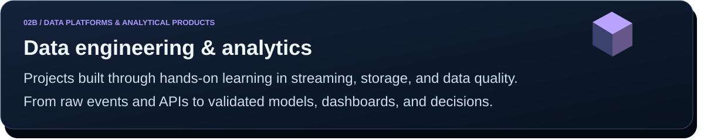
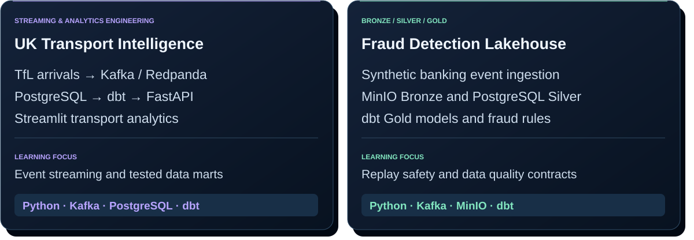
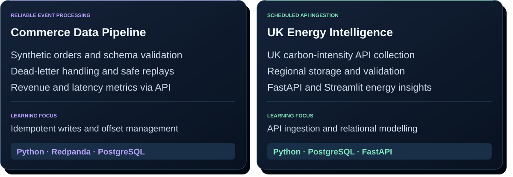
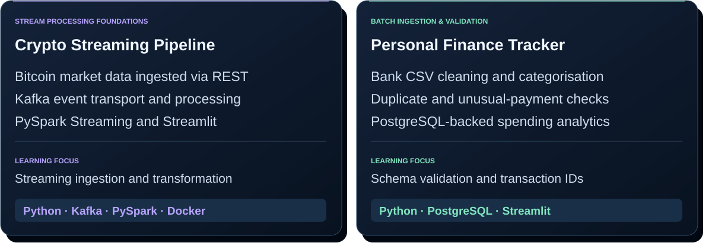
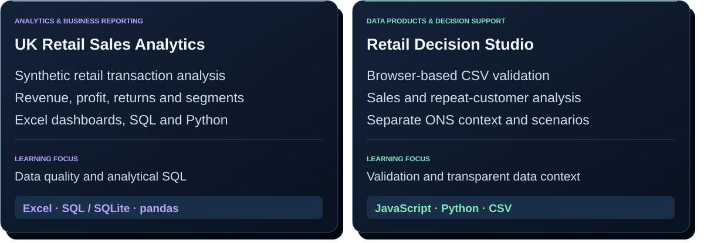

<!-- Custom SVG portfolio for Santhosh Banoth. All artwork is stored in this repository. -->

  

[Read case study](https://github.com/Banoth281/soc-login-lab/blob/main/windows-event-investigation/CASE-STUDY.md) · [Source code](https://github.com/Banoth281/soc-login-lab/tree/main/windows-event-investigation/powershell) · [Local evidence](https://github.com/Banoth281/soc-login-lab/blob/main/windows-event-investigation/evidence/LOCAL-V2-VALIDATION.md)

[Read case study](https://github.com/Banoth281/soc-login-lab/blob/main/phishing-email-investigation/CASE-STUDY.md) · [Source code](https://github.com/Banoth281/soc-login-lab/tree/main/phishing-email-investigation) · [Validation](https://github.com/Banoth281/soc-login-lab/blob/main/phishing-email-investigation/VALIDATION.md)

[Explore repository](https://github.com/Banoth281/soc-password-spray-lab) · [Investigation](https://github.com/Banoth281/soc-password-spray-lab/blob/main/investigation.md) · [Technical audit](https://github.com/Banoth281/soc-password-spray-lab/blob/main/AUDIT.md)

Controlled personal labs: Windows includes actual local test events; phishing and multi-account fixtures are synthetic. Counts describe documented validation runs; badges show current workflow status. No production deployment or confirmed intrusion is claimed.

  

[Explore UK Transport Intelligence](https://github.com/Banoth281/uk-live-transport-intelligence) · [Explore Fraud Detection Lakehouse](https://github.com/Banoth281/real-time-fraud-detection-lakehouse)

[Explore Commerce Data Pipeline](https://github.com/Banoth281/real-time-commerce-data-pipeline) · [Explore UK Energy Intelligence](https://github.com/Banoth281/live-uk-energy-intelligence)

[Explore Crypto Streaming Pipeline](https://github.com/Banoth281/realtime-crypto-pipeline) · [Explore Personal Finance Tracker](https://github.com/Banoth281/smart-personal-finance-tracker)

[Explore UK Retail Sales Analytics](https://github.com/Banoth281/uk-retail-sales-analytics) · [Explore Retail Decision Studio](https://github.com/Banoth281/retail-growth-retention-decision-studio)

Personal engineering and learning projects. Summaries follow the linked repository documentation; this profile update does not independently verify runtime or deployment status. Commerce, banking, and retail examples use synthetic data. Some hosted dashboards use saved demo snapshots when their backend is unavailable.

  

<a href="https://www.linkedin.com/in/banoth281/"><b>Connect on LinkedIn</b></a> &nbsp; · &nbsp;
<a href="mailto:Santhoshbanoth971@gmail.com"><b>Email Santhosh</b></a> &nbsp; · &nbsp;
<a href="https://github.com/Banoth281?tab=repositories"><b>Browse all repositories</b></a>

